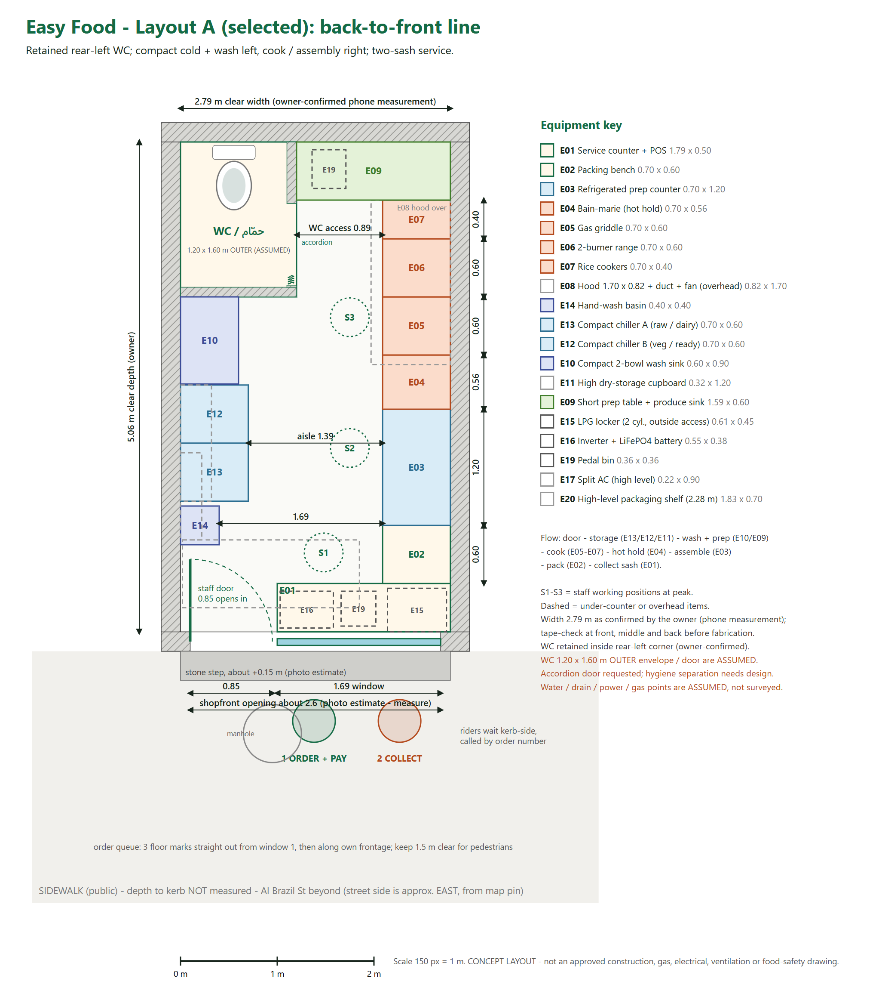
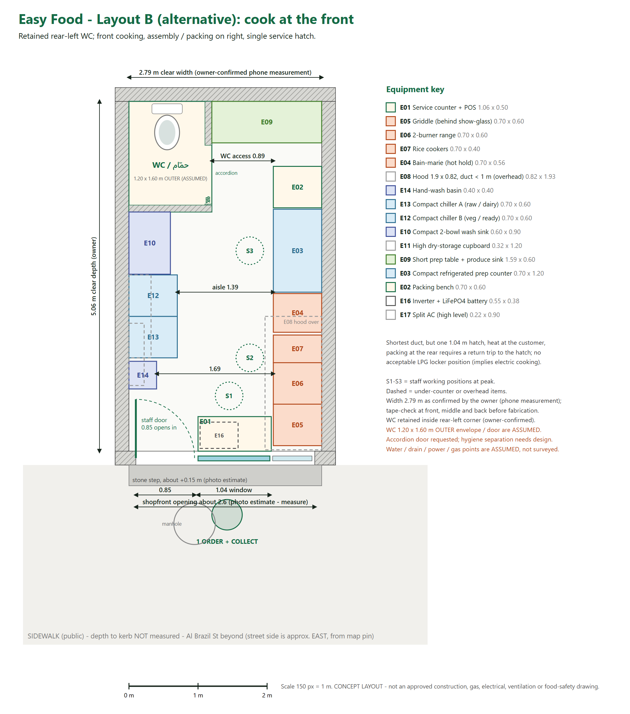

# 5. Revised layouts — rear-left WC retained

**Revision: 16 November 2026, following owner confirmation.** The existing toilet is INSIDE the rear-left corner near the former E09/E10 and must remain. This replaces the earlier layout that used the whole rear-left corner for kitchen equipment.

Concept only: room 2.79 × 5.06 m clear; ceiling 3.00 m assumed. Coordinates are metres from the front-left inside corner. The WC location is confirmed; its **outer 1.20 × 1.60 m envelope**, 0.10 m partitions and opening are assumptions pending measurement.

## Layout A — selected, with compact equipment

- Rear left: retained WC, x=0–1.20, depth=3.46–5.06. Accordion door on the aisle side, shown folded. Structural opening 0.85 m; approximately 0.70 m remains after jambs and folded panels. Door details and position are provisional.
- Left wall: dedicated hand basin, two narrower upright chillers, then the 0.90 m two-bowl wash sink in front of the WC. The former dry floor rack becomes a closed high cupboard above the chillers.
- Rear right: E09 becomes a 1.59 × 0.60 m prep table with separate produce sink and red board. It starts at x=1.20, outside the WC.
- Right wall: packing 0.60 m, saladette 1.20 m, hot hold 0.56 m, griddle 0.60 m, range 0.60 m and rice bench 0.40 m. Rear prep occupies the last 0.60 m of shop depth.
- Two service sashes and the outside-access gas locker remain. The hood moves forward and becomes 1.70 × 0.82 m over the revised hot line.

Working aisle beside chillers: **1.39 m**. WC approach beside its wall: **0.89 m**. This rear strip is a single-person pinch point, not space for two staff to pass. Keep it clear of boxes, bins and mobile equipment. The fold door avoids a hinged sweep but does not widen the corridor.

## Layout B — alternative, same retained WC

Both layouts share the retained WC, left wash/cold bank and rear-right prep table. B keeps cooking at the front, moves assembly to the right middle and packing farther back. Packed food must return to the single front hatch. The short hood duct is retained; B remains an electric-cooking concept because its previous gas-location limitation is unresolved.

## Geometric equipment schedule — A

Footprints below are model dimensions; actual purchased capacities and service clearances require supplier checks. **The old pair of nominal 600 L units is replaced by narrower footprints; the same storage capacity is not claimed.** Earlier equipment prices are not new quotations for this revision.

| Code | Item | Across x (m) | Depth y (m) | Footprint (m) | Reference height (m) |
|---|---|---|---|---|---|
| E01 | Service counter + POS | 1.00–2.79 | 0.00–0.50 | 1.79 × 0.50 | 0.90 |
| E02 | Packing bench | 2.09–2.79 | 0.50–1.10 | 0.70 × 0.60 | 0.90 |
| E03 | Refrigerated prep counter | 2.09–2.79 | 1.10–2.30 | 0.70 × 1.20 | 0.90 |
| E04 | Bain-marie (hot hold) | 2.09–2.79 | 2.30–2.86 | 0.70 × 0.56 | 0.90 |
| E05 | Gas griddle | 2.09–2.79 | 2.86–3.46 | 0.70 × 0.60 | 0.90 |
| E06 | 2-burner range | 2.09–2.79 | 3.46–4.06 | 0.70 × 0.60 | 0.90 |
| E07 | Rice cookers | 2.09–2.79 | 4.06–4.46 | 0.70 × 0.40 | 0.55 |
| E08 | Hood 1.70 x 0.82 + duct + fan (overhead) | 1.97–2.79 | 2.76–4.46 | 0.82 × 1.70 | 1.95 |
| E14 | Hand-wash basin | 0.00–0.40 | 0.90–1.30 | 0.40 × 0.40 | 0.86 |
| E13 | Compact chiller A (raw / dairy) | 0.00–0.70 | 1.35–1.95 | 0.70 × 0.60 | 2.00 |
| E12 | Compact chiller B (veg / ready) | 0.00–0.70 | 1.95–2.55 | 0.70 × 0.60 | 2.00 |
| E10 | Compact 2-bowl wash sink | 0.00–0.60 | 2.56–3.46 | 0.60 × 0.90 | 0.90 |
| E11 | High dry-storage cupboard | 0.00–0.32 | 1.35–2.55 | 0.32 × 1.20 | 2.12 |
| E09 | Short prep table + produce sink | 1.20–2.79 | 4.46–5.06 | 1.59 × 0.60 | 0.90 |
| E15 | LPG locker (2 cyl., outside access) | 2.14–2.75 | 0.00–0.45 | 0.61 × 0.45 | 0.80 |
| E16 | Inverter + LiFePO4 battery | 1.03–1.58 | 0.04–0.42 | 0.55 × 0.38 | 0.80 |
| E19 | Pedal bin | 1.66–2.02 | 0.06–0.42 | 0.36 × 0.36 | 0.62 |
| E17 | Split AC (high level) | 0.00–0.22 | 0.95–1.85 | 0.22 × 0.90 | 2.60 |
| E20 | High-level packaging shelf (2.28 m) | 0.02–1.85 | 0.25–0.95 | 1.83 × 0.70 | 2.28 |

Heights for overhead items are mounting reference levels, not overall unit height. E19 has a second bin under rear prep. WC fixtures are recorded separately in `model/layout-A.json` under `rooms` and labelled WC, so E01–E21 codes retain their meanings.

## Fit checks and remaining decisions

- Automated checks reject kitchen equipment overlapping the WC envelope or blocking its approach strip. Both layouts pass at widths 2.70, 2.79 and 2.95 m using the assumed WC.
- Widths 2.45 and 2.60 m now fail the chosen 0.80 m WC-approach design allowance. The earlier minimum-width assertion no longer applies. This allowance is a modelling choice, not a local legal standard.
- Right line A: 0.50 service + 0.60 packing + 1.20 prep counter + 0.56 hot hold + 0.60 griddle + 0.60 range + 0.40 rice + 0.60 rear prep = 5.06 m. Tape-check and leave fabrication tolerances before procurement.
- The WC takes 1.92 m² of the shop rectangle, leaving about 12.20 m² outside its envelope, including all equipment and aisles. This is not net standing space.
- Preserve the dedicated kitchen hand basin. WC hand-washing is shown separately. Exhaust, drain connections and waterproofing for the retained WC remain to be surveyed.
- **Hygiene separation remains unresolved:** an accordion door saves movement space; it does not establish sanitary separation from food preparation. A local designer must resolve the entrance separation and independent exhaust before fit-out. See [FAO/Codex hygiene guidance](https://www.fao.org/4/V5030E/V5030E0t.htm) and the WC revision note. No claim of local approval is made.
- Earlier throughput, storage, electrical and investment estimates need review against the smaller equipment and retained WC. No new capacity or cost quotation has been established by this model.
